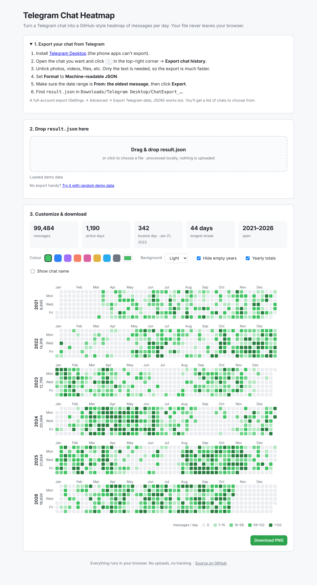
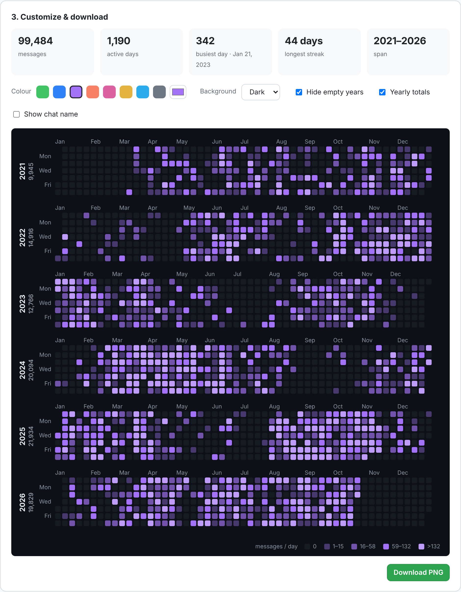

# Telegram Chat Heatmap

<!-- Replace USERNAME and REPO in the three badge URLs below -->


Turn a Telegram chat export into a GitHub-style contribution heatmap: one square per day, coloured by how many messages you exchanged.

**Everything runs in your browser.** Your chat file is never uploaded anywhere.



## Use it

1. Install [Telegram Desktop](https://desktop.telegram.org/). The phone apps can't export.
2. Open a chat → **⋮** (top right) → **Export chat history**.
3. Untick all media, set **Format → Machine-readable JSON**, and set the date range to start from the oldest message.
4. Open the page and drag in `result.json` from `Downloads/Telegram Desktop/ChatExport_…`.
5. Pick a colour and a light or dark background, then click **Download PNG**.

Full-account exports (Settings → Advanced → Export Telegram data) also work. You'll get a dropdown with all your chats.

## Features

- Drag & drop or file picker, plus a demo-data button
- Colour presets and a custom colour picker
- Light / dark background
- Hide empty years, show/hide yearly totals, optionally show the chat name
- Hover a day to see its message count
- Stats: total messages, active days, busiest day, longest streak
- High-resolution PNG export, ready for Twitter/X
- A single static `index.html` with no dependencies and no build step



## Host it on GitHub Pages

1. Create a new repository and push these files.
2. **Settings → Pages → Build and deployment → Source: Deploy from a branch**, then pick `main` and `/ (root)`.
3. Your page will be live at `https://<username>.github.io/<repo>/`.

## How counting works

Only entries with `"type": "message"` are counted, so service events like calls, pins and joins are skipped. The day comes from the timestamp in the export, which is in your local time. Colour levels are the quartiles of your active days, like GitHub.

## Usage counter

The page keeps three anonymous counts using the free [Abacus](https://abacus.jasoncameron.dev) API: **visits**, **heatmaps made** (a real file loaded, at most once per visit; the demo doesn't count) and **PNG downloads**. Only the counter is incremented. No chat data, names or numbers from your file are ever sent.

The totals are shown at the bottom of the page, and you can also check them directly:

```
https://abacus.jasoncameron.dev/get/USERNAME.github.io/REPO-heatmaps
https://abacus.jasoncameron.dev/get/USERNAME.github.io/REPO-downloads
https://abacus.jasoncameron.dev/get/USERNAME.github.io/REPO-visits
```

The counter is off when the page is opened locally (`file://` or `localhost`), so testing doesn't inflate it.

## License

MIT
